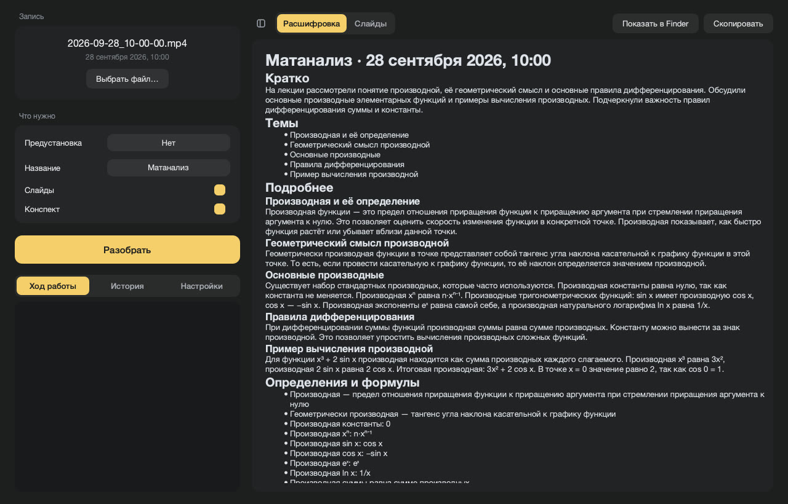
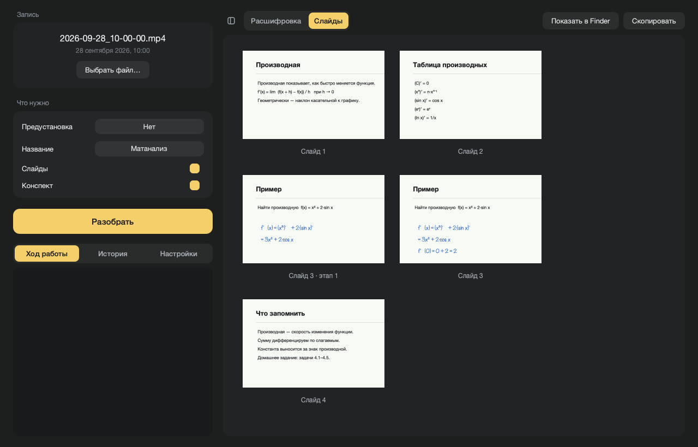

# Lectures

Turns a lecture recording into a full transcript and a set of slides,
entirely on your Mac.

[Русский](#lectures-1)



## Download

**[Lectures.dmg](https://github.com/Drtonix/lectures/releases/latest/download/Lectures.dmg)**
— 308 MB.

First launch goes through right-click → **Open** → **Open**. Then download
Whisper in Settings, and a language model if you want notes.

## Requirements

Apple Silicon, macOS 13 or newer. Intel Macs are not supported.

| Model | Size | RAM | Needed for |
|---|---|---|---|
| Whisper large-v3 | 2.9 GB | 16 GB | transcript |
| Qwen3.5-9B, 4-bit | 5.6 GB | 16 GB | notes |
| Qwen3.6-35B-A3B, 4-bit | 19 GB | 32 GB | notes |

## Measured

Test machine: MacBook Pro, M4 Max, 36 GB, macOS 27. Cold start included.

| Job | Time |
|---|---|
| 80-minute webinar: transcript and slides | 5 min 9 s |
| the same webinar, slides alone | 42 s |
| 7-minute excerpt: transcript, slides and notes (previous Qwen3-30B) | 58 s |

## Features

**Transcript.** Whisper large-v3, locally. The recording is cut into
four-minute pieces at quiet points, each with its own punctuation prompt, so
punctuation holds for the whole lecture. Hallucinations on silence and repeat
loops are filtered out. Paragraphs carry timestamps.

**Slides, without a neural network.** The video is read at one frame per
second. Webcam, chat and other windows that keep changing are ignored; a slide
is a stretch where the rest of the screen stays still. A scrolled document is
stitched into whole pages, and viewer panels fixed on top of it are trimmed
away. About 30 seconds per hour of video.

**Pen annotations.** The main image of each slide is its final version,
with everything written on it. The stages in between — said something, wrote
something — are kept as `Slide 07.1`, `Slide 07.2` and placed in the
transcript at the moment they appeared.



**Slide text.** Read with the macOS text recognizer and put under each slide
in the transcript. Letters blurred by video compression are corrected against
the macOS dictionary.

**Notes on top.** Optional: a summary with topics, definitions and
assignments, written by a local Qwen above the transcript.

**PDF.** Transcript and slides in one file.

**Presets.** A name and a folder per subject: pick one and the title is
filled in, files go straight into that folder.

**Files.** Named after the recording time, the way OBS names them:
`Transcript Title — 2026-09-28_10-00-00.md`, the PDF next to it, slides in a
folder.

**History.** Past lectures, reopened from the list.

**Languages.** Russian and English, both interface and notes. Light and dark appearance.

## Build

```
git clone git@github.com:Drtonix/lectures.git
cd lectures
./build_app.sh
```

The first run compiles FFmpeg from source, which takes a while. Output is
`build/Lectures.app`, about 990 MB. `./make_dmg.sh` packs the installer and
needs `pip install dmgbuild`.

To run from source: install `PySide6 mlx-lm mlx-whisper soundfile numpy
pyobjc-framework-Vision pyobjc-framework-Quartz` into a virtualenv, start
`python app.py`, keep FFmpeg on `PATH`.

## Limits

- Slides are found on screen recordings: presentations, documents, a pen.
  A camera pointed at a blackboard gives nothing useful.
- Formulas on slides are not read as text.
- Tuned and tested on webinar recordings with a scrolled PDF and pen notes.

## Support

[DonationAlerts](https://www.donationalerts.com/r/bdub) · [DALINK](https://dalink.to/bdub) · [CloudTips](https://pay.cloudtips.ru/p/4a29ea73)

USDT TRC-20: `TEzUu8mVuNS1faHGobMWifmvErTuKUSkPD`

## License

MIT, see [LICENSE](LICENSE). Bundled components and model weights are listed in
[THIRD-PARTY.md](THIRD-PARTY.md).

DrTonix · [bdub.space](https://bdub.space)

---

# Lectures

Превращает запись лекции в полную расшифровку и набор слайдов целиком на
вашем Mac.

[English](#lectures)


## Установка

**[Lectures.dmg](https://github.com/Drtonix/lectures/releases/latest/download/Lectures.dmg)**
— 308 МБ.

Первый запуск — через правую кнопку → **Открыть** → **Открыть**. Дальше
скачать Whisper в настройках, а для конспекта — ещё и языковую модель.

## Требования

Apple Silicon, macOS 13 или новее. Mac на Intel не поддерживаются.

| Модель | Размер | Память | Для чего |
|---|---|---|---|
| Whisper large-v3 | 2,9 ГБ | 16 ГБ | расшифровка |
| Qwen3.5-9B, 4 бита | 5,6 ГБ | 16 ГБ | конспект |
| Qwen3.6-35B-A3B, 4 бита | 19 ГБ | 32 ГБ | конспект |

## Замеры

Тестовая машина: MacBook Pro, M4 Max, 36 ГБ, macOS 27. С холодного старта.

| Задача | Время |
|---|---|
| 80-минутный вебинар: расшифровка и слайды | 5 мин 9 с |
| тот же вебинар, только слайды | 42 с |
| 7-минутный отрывок: расшифровка, слайды и конспект (прежняя Qwen3-30B) | 58 с |

## Возможности

**Расшифровка.** Whisper large-v3 на месте. Запись режется на куски по четыре
минуты в тихих местах, у каждого своя подсказка про знаки препинания — они
держатся на всю лекцию. Выдумки на тишине и зацикливания отсекаются. Абзацы с
отметками времени.

**Слайды без нейросети.** Видео читается по кадру в секунду. Вебка, чат и
другие постоянно меняющиеся окна не учитываются, слайд — это отрезок, где
остальной экран стоит. Прокручиваемый документ склеивается в целые страницы,
а неподвижные панели просмотрщика поверх него срезаются. Около 30 секунд на
час видео.

**Пометки пером.** Главная картинка слайда — финальная, со всем, что на нём
дописали. Промежуточные этапы — что-то сказал, что-то дописал — сохраняются
как `Слайд 07.1`, `Слайд 07.2` и стоят в расшифровке там, где появились.


**Текст слайдов.** Читается встроенным в macOS распознаванием и стоит под
каждым слайдом в расшифровке. Буквы, размытые сжатием видео, правятся по
словарю macOS.

**Конспект сверху.** По желанию: сводка с темами, определениями и заданиями,
её пишет локальная Qwen над расшифровкой.

**PDF.** Расшифровка и слайды одним файлом.

**Предустановки.** Название и папка на каждый предмет: выбрали — название
подставилось, файлы легли прямо в эту папку.

**Файлы.** Называются по времени записи, как их называет OBS:
`Расшифровка Название — 2026-09-28_10-00-00.md`, рядом PDF, слайды в папке.

**История.** Прошлые лекции открываются из списка.

**Языки.** Русский и английский — и интерфейс, и конспекты. Светлое и тёмное оформление.

## Сборка

```
git clone git@github.com:Drtonix/lectures.git
cd lectures
./build_app.sh
```

Первый запуск собирает FFmpeg из исходников, это долго. На выходе
`build/Lectures.app`, около 990 МБ. `./make_dmg.sh` собирает установочный
образ и требует `pip install dmgbuild`.

Запуск из исходников: поставить в виртуальное окружение `PySide6 mlx-lm
mlx-whisper soundfile numpy pyobjc-framework-Vision pyobjc-framework-Quartz`,
запустить `python app.py`, FFmpeg должен быть в `PATH`.

## Ограничения

- Слайды ищутся на записях экрана: презентации, документы, перо. Камера,
  снимающая доску, ничего полезного не даст.
- Формулы на слайдах текстом не читаются.
- Настроено и проверено на записях вебинаров с прокруткой PDF и пометками
  пером.

## Поддержать

[DonationAlerts](https://www.donationalerts.com/r/bdub) · [DALINK](https://dalink.to/bdub) · [CloudTips](https://pay.cloudtips.ru/p/4a29ea73)

USDT TRC-20: `TEzUu8mVuNS1faHGobMWifmvErTuKUSkPD`

## Лицензия

MIT, см. [LICENSE](LICENSE). Компоненты в составе приложения и веса моделей
перечислены в [THIRD-PARTY.md](THIRD-PARTY.md).

DrTonix · [bdub.space](https://bdub.space)
